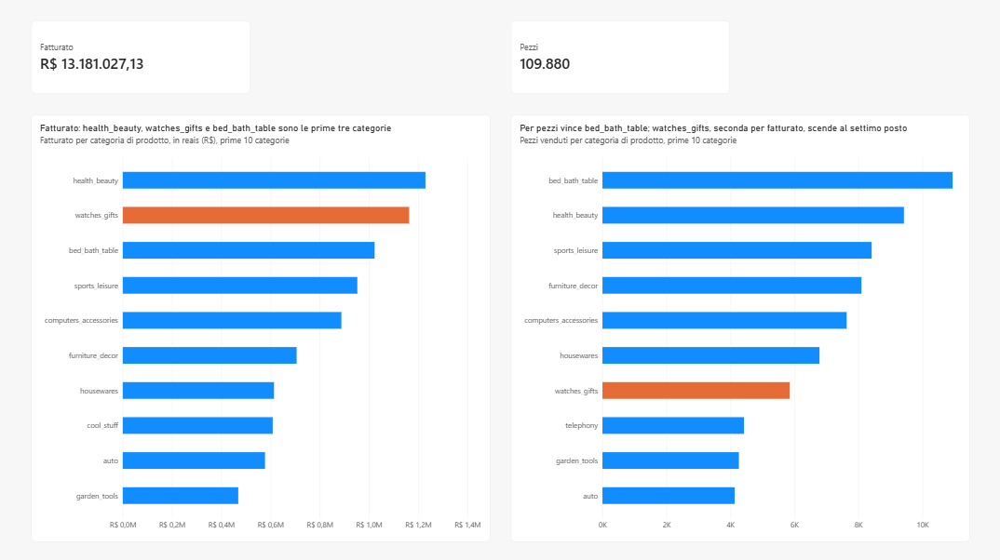
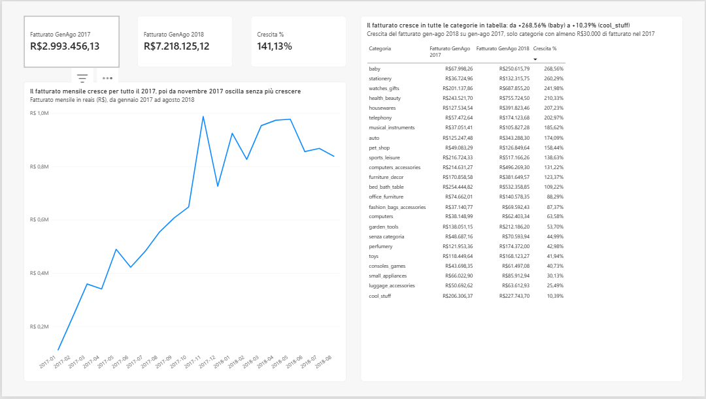
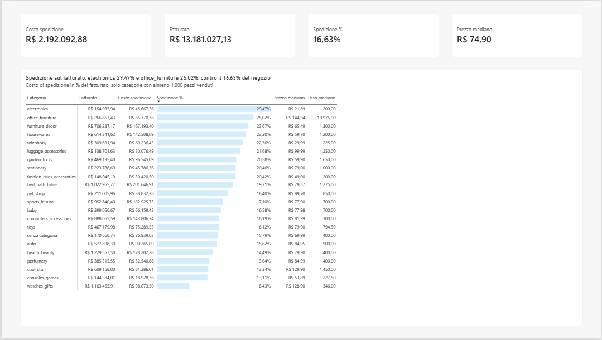
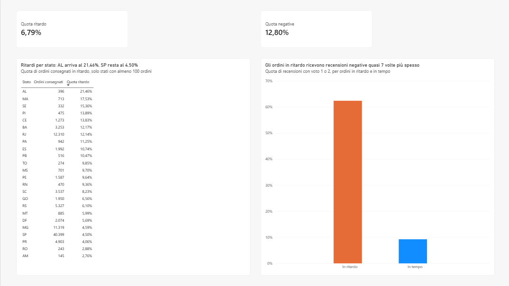

# Analisi e-commerce Olist: vendite, spedizioni e recensioni

Analisi di 96.211 ordini consegnati di un marketplace brasiliano (dataset pubblico Olist, gennaio 2017 – agosto 2018): quali categorie vendono di più, come crescono le vendite nel tempo, quanto pesa la spedizione sul prezzo e se i ritardi di consegna peggiorano le recensioni.

Progetto completo, dai file grezzi alla dashboard: dati caricati e puliti in **PostgreSQL**, analisi in **SQL**, dashboard in **Power BI**, numeri verificati con un secondo strumento (**Excel**).

## Risultati

### 1. Quali categorie vendono di più?

**Fatturato e pezzi danno due classifiche diverse.** health_beauty è 1ª per fatturato (9,33% del totale), bed_bath_table è 1ª per pezzi (9,96%). watches_gifts è 2ª per fatturato (8,83%) ma solo 7ª per pezzi: vende pezzi che valgono più della media.

**E quindi:** "chi vende di più" ha due risposte. Il fatturato dice dove stanno i ricavi, i pezzi dove si concentra il lavoro di magazzino e spedizione: per decidere servono tutte e due le classifiche.



*Fatturato = valore della merce venduta (somma dei prezzi, spedizione esclusa). Non sono i ricavi di Olist: è un marketplace e guadagna commissioni, che nel dataset non ci sono.*

### 2. Come cambiano le vendite nel tempo, quali categorie crescono?

**Il 2017 è l'anno della crescita, il 2018 della stabilità.** Il fatturato mensile sale per tutto il 2017, tocca il massimo a novembre 2017 (988 mila R$) e nel 2018 resta tra 826 e 978 mila R$ al mese. A parità di mesi (gennaio-agosto) il 2018 fa **+141,13%** sul 2017: 7,22 milioni di R$ contro 2,99.

**Tutte le categorie crescono, ma non allo stesso ritmo.** Tra le 24 categorie con almeno 30.000 R$ di fatturato nel 2017 nessuna cala. 9 crescono più del negozio (in testa baby +268,56%, stationery +260,29%, watches_gifts +241,98%, health_beauty +210,33%), le altre 15 crescono meno e quindi perdono quota. Ultima cool_stuff: +10,39%.

**E quindi:** crescere non basta. Con il negozio a +141%, una categoria a +100% sta perdendo terreno: la crescita di ogni categoria va letta rispetto a quella del negozio. Il fatturato si concentra sulle categorie che già vendevano di più (watches_gifts, health_beauty). cool_stuff è il caso da approfondire: il perché (assortimento, venditori, prezzi) con questi dati non si vede.



*Il confronto usa gli stessi mesi (gennaio-agosto) perché i dati del 2018 si fermano ad agosto: 12 mesi contro 8 gonfierebbero il risultato. La soglia di 30.000 R$ evita percentuali enormi su categorie piccole. Ipotesi non verificata: il picco di novembre 2017 è il Black Friday.*

### 3. Quanto pesa la spedizione sul prezzo, per categoria?

**Su 100 R$ di merce il cliente paga in media 16,63 R$ di spedizione.** Per categoria si va dall'8,43% di watches_gifts al 29,47% di electronics: 12 categorie su 22 stanno sopra la media del negozio.

**La spedizione pesa tanto per due motivi diversi:**
- **prezzo basso**: electronics (prezzo tipico 21,89 R$, 29,47%), telephony (29,99 R$, 22,36%);
- **peso alto**: office_furniture (peso tipico 10.975 g, 25,02%), furniture_decor (1.300 g, 23,67%).

**E quindi:** sono due problemi con rimedi diversi (ipotesi di intervento, non risultati). Per i prodotti economici, la spedizione gratuita sopra una soglia di spesa spinge a comprare più pezzi insieme. Per i mobili, la leva sono le tariffe dei corrieri per peso.



*Quota spedizione = somma delle spedizioni / somma dei prezzi: un rapporto tra somme, non la media dei rapporti pezzo per pezzo (che verrebbe gonfiata dai pezzi da pochi R$). Prezzo e peso "tipici" = mediana. Solo categorie con almeno 1.000 pezzi venduti.*

### 4. I ritardi di consegna peggiorano le recensioni? In quali stati si consegna peggio?

**Sì, e di molto.** Il 6,67% degli ordini arriva in ritardo. Tra questi le recensioni negative (voto 1-2) sono il **62,42%**, contro il **9,25%** degli ordini in tempo: quasi 7 volte tanto. Questi pochi ordini producono circa un terzo di tutte le recensioni negative.

**Più il ritardo è lungo, peggio è.** Negative: 32,14% con 1-3 giorni di ritardo, 67,68% con 4-7 giorni, 80,15% con 8-14 giorni, poi il valore si ferma.

**Dove si consegna peggio:** la quota di ordini in ritardo è più alta nel nord-est (AL 21,46%, MA 17,53%, SE 15,36%, PI 13,89%, CE 13,83%). Rio de Janeiro (RJ), secondo mercato con 12.310 ordini, ha il 12,14% di ritardi: quasi 3 volte San Paolo (SP, 4,50%). Lontano non vuol dire in ritardo: l'Amazonas (AM) ha la consegna più lenta (26 giorni mediani) ma solo il 2,76% di ritardi.

**E quindi:** ridurre i ritardi è la leva più forte sulle recensioni, perché riguarda pochi ordini ma un terzo delle negative, e conta soprattutto non sforare la prima settimana. Le priorità: RJ per numero di ordini in ritardo (circa 1.500), il nord-est per quota. Le recensioni peggiorano con il ritardo rispetto alla data promessa, non con i giorni di viaggio: dove la data stimata è realistica, anche una consegna lunga non è un ritardo.



*Ritardo = consegna dopo la data stimata comunicata al cliente. I dati mostrano un legame forte, non una prova di causa: lo stesso venditore, per esempio, potrebbe causare sia ritardi sia prodotti difettosi. Solo stati con almeno 100 ordini.*

## Come ho lavorato

1. **Esplorazione in Python (pandas)**: struttura delle tabelle, valori mancanti, periodo coperto. Da qui la scelta del periodo: i primi e gli ultimi mesi del dataset sono incompleti, quindi analizzo gennaio 2017 – agosto 2018 (20 mesi completi). → `notebooks/01_esplorazione.ipynb`
2. **Caricamento in PostgreSQL**: uno script Python carica i CSV nello schema `raw`, come testo e senza modifiche (copia fedele dei file). → `scripts/01_carica_raw.py`, `sql/00`, `sql/01`
3. **Controlli di qualità in SQL**: ordini consegnati senza data di consegna, ordini senza prodotti, prodotti mai venduti. Per ognuno: quanti sono e cosa ne faccio. → `sql/02_verifiche_qualita.sql`
4. **Strato pulito**: schema `clean` con tipi corretti, solo ordini consegnati nel periodo, una sola recensione per ordine (la più recente), categorie tradotte in inglese (2 a mano, perché senza traduzione) e "senza categoria" al posto dei valori vuoti. Ogni tabella ha una query di verifica su righe e chiavi. → `sql/03_strato_pulito.sql`
5. **Analisi SQL**: una o più query per ogni domanda. Nei commenti: risultato atteso, risultato ottenuto, dati, "e quindi?" e ipotesi tenute separate dai fatti. → `sql/04_analisi.sql`
6. **Dashboard Power BI** collegata allo schema `clean`: 4 pagine, una per domanda, con misure DAX e una tabella calendario. I titoli dei grafici dicono il risultato, non solo l'argomento. → `powerbi/dashboard_olist.pbix`
7. **Verifica in Excel**: gli stessi numeri ricalcolati con tabelle pivot, senza passare da Power BI. → `excel/verifica_olist.xlsx`

## Strumenti

| Strumento | Uso nel progetto |
|---|---|
| PostgreSQL 18 (in Docker) | database: schema `raw` (dati originali) e `clean` (dati puliti) |
| SQL | controlli di qualità, pulizia, analisi (JOIN, CTE, funzioni finestra, CASE WHEN, mediane) |
| Python (pandas, SQLAlchemy) | esplorazione dei CSV e caricamento nel database |
| Power BI | dashboard (modello dati, misure DAX, 4 pagine) |
| Excel | tabelle pivot di verifica dei numeri della dashboard |
| DBeaver, VS Code, Git/GitHub | scrittura delle query, notebook, versionamento |

## Verifica dei numeri

I numeri principali della dashboard sono stati ricalcolati in Excel con tabelle pivot, partendo da un export dello schema `clean` (109.880 righe, una per pezzo venduto).

| Metrica | Power BI | Excel | Esito |
|---|---|---|---|
| Fatturato | 13.181.027,13 R$ | 13.181.027,13 R$ | OK |
| Pezzi venduti | 109.880 | 109.880 | OK |
| Costo spedizione | 2.192.092,88 R$ | 2.192.092,88 R$ | OK |
| Quota spedizione | 16,63% | 16,63% | OK |
| Fatturato gen-ago 2017 | 2.993.456,13 R$ | 2.993.456,13 R$ | OK |
| Fatturato gen-ago 2018 | 7.218.125,12 R$ | 7.218.125,12 R$ | OK |
| Crescita gen-ago | 141,13% | 141,13% | OK |

**E quindi:** Excel non usa le misure DAX, quindi se i due strumenti danno lo stesso numero è molto difficile che siano sbagliati tutti e due.
**Cosa non verifica:** la pulizia dei dati, perché entrambi partono dallo schema `clean`. Quella è controllata in SQL, con una query di verifica per ogni tabella (`sql/03_strato_pulito.sql`).

## Limiti

- **Fatturato non vuol dire ricavi**: è il valore della merce venduta. Olist guadagna commissioni, che nel dataset non ci sono.
- **Classifica delle categorie**: "senza categoria" vale l'1,29% del fatturato, più del distacco tra 1ª e 2ª (circa 66 mila R$). L'ordine dei primi posti quindi non è certo.
- **Ritardi e recensioni**: il legame è forte e cresce con i giorni di ritardo, ma i dati non dimostrano la causa.
- **Spedizione**: uso il peso, non il volume. Un prodotto leggero ma ingombrante costa da spedire più di quanto dica il peso.
- **Stati piccoli**: sotto i 400 ordini (AL, SE, TO, RO, AM) le quote di ritardo sono meno stabili.
- **Ordini esclusi**: solo ordini consegnati. Nella domanda 4 restano fuori 643 ordini senza recensione (0,7%) e 8 senza data di consegna. Giugno-agosto 2018 potrebbero essere sottostimati, perché alcuni ordini erano forse ancora in viaggio quando il dataset è stato estratto.
- **Tabelle non usate**: venditori, pagamenti e geolocalizzazione non fanno parte del progetto.

**Cosa farei dopo:**
- aggiungere i venditori, per capire se i ritardi di RJ e del nord-est (e il calo di cool_stuff) dipendono da pochi venditori;
- confrontare per stato la data stimata con la consegna reale, per capire se il problema è la consegna o una promessa troppo ottimista;
- usare le dimensioni dei prodotti per stimare il volume nella domanda 3.

## Struttura delle cartelle

```
analisi-ecommerce-olist/
├── data/                 CSV originali di Olist (non inclusi: vanno scaricati da Kaggle)
├── notebooks/
│   └── 01_esplorazione.ipynb      esplorazione dei CSV con pandas
├── scripts/
│   └── 01_carica_raw.py           caricamento dei CSV nello schema raw
├── sql/
│   ├── 00_crea_schema_raw.sql     crea lo schema raw
│   ├── 01_verifica_raw.sql        conta le righe caricate
│   ├── 02_verifiche_qualita.sql   controlli di qualità sui dati raw
│   ├── 03_strato_pulito.sql       schema clean, con verifiche
│   └── 04_analisi.sql             analisi sulle 4 domande di business
├── powerbi/
│   └── dashboard_olist.pbix       dashboard
├── excel/
│   └── verifica_olist.xlsx        pivot di verifica
├── immagini/                      screenshot della dashboard
└── docker-compose.yml             database PostgreSQL in Docker
```

## Come riprodurre

Serve: Docker Desktop, Python 3, un client SQL (io ho usato DBeaver), Power BI Desktop.

1. Scarica i CSV da [Kaggle](https://www.kaggle.com/datasets/olistbr/brazilian-ecommerce) e mettili nella cartella `data/`.
2. Avvia il database: `docker compose up -d` (PostgreSQL 18 sulla porta 5434, database `olist`; utente e password sono nel `docker-compose.yml`, solo per uso locale).
3. Installa le librerie Python: `pip install pandas sqlalchemy psycopg2-binary`
4. Esegui `sql/00_crea_schema_raw.sql`.
5. Carica i dati: `python scripts/01_carica_raw.py`
6. Esegui in ordine `sql/01`, `02`, `03` e `04`.
7. Apri `powerbi/dashboard_olist.pbix`. I dati sono già importati; per aggiornarli dal database: Home → Refresh (Aggiorna).

## Fonte dei dati e licenza

Dati: [Brazilian E-Commerce Public Dataset by Olist](https://www.kaggle.com/datasets/olistbr/brazilian-ecommerce), pubblicato da Olist su Kaggle con licenza [CC BY-NC-SA 4.0](https://creativecommons.org/licenses/by-nc-sa/4.0/). Sono dati commerciali reali, anonimizzati da Olist.

I file di questo repository che contengono dati derivati dal dataset (`powerbi/dashboard_olist.pbix`, `excel/verifica_olist.xlsx`) sono distribuiti con la stessa licenza, CC BY-NC-SA 4.0.
